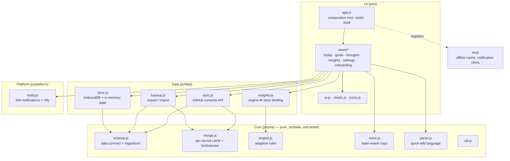
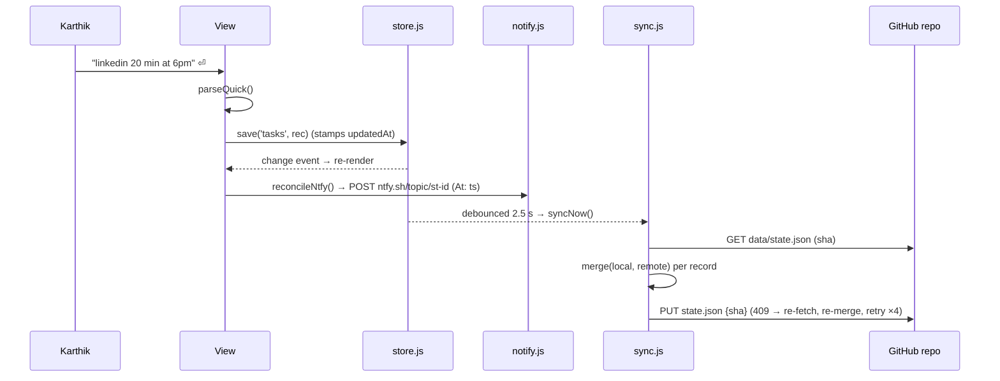

# Architecture

Steady is a static, dependency-free PWA: plain ES modules, HTML and CSS, served from any static host (GitHub Pages today). There is no build step and no backend.

## Layers

| Module | Responsibility | May depend on |
| --- | --- | --- |
| `core/*` | Data contract, merge, adaptive rules, copy, parsing. Pure functions only. | `core/*` |
| `data/store.js` | IndexedDB persistence, in-memory cache, change events, local migrations. | `core/schema` |
| `data/sync.js` | Read/merge/write `data/state.json` with sha concurrency; pairing keys; Hark snapshot. | `store`, `core/merge`, `core/schema` |
| `data/backup.js` | Export/import JSON through the same merge rules. | `store`, `sync`, `core/schema` |
| `data/insights.js` | Feeds live store data into the pure engine. | `store`, `core/engine` |
| `platform/notify.js` | Notification permission, SW notifications, ntfy schedule reconciliation. | `store` |
| `ui/*` | Rendering and interaction. | everything above |

A native port replaces `data/store.js`, `platform/notify.js` and `ui/*`; `core/*` and the on-repo JSON format carry over unchanged (see PORTING.md).

## Data flow: a change

## Sync triggers
App open · window focus / visibility (if last sync > 20 s) · `online` event · 2.5 s after any local change · every 4 min while visible · *Sync now*.

## Offline
`sw.js` precaches the full shell (HTML, CSS, every module, fonts, icons) and serves it stale-while-revalidate; navigations fall back to cached `index.html`. Network calls to GitHub and ntfy are never cached. Bump `VERSION` in `sw.js` on each release.

## Security & privacy
- Tokens are stored only in the device's IndexedDB (`local` store), never synced, never logged. The pairing key contains the token by design; the UI says so.
- ntfy topics are long random strings (`steady-` + 18 chars of a 32-symbol alphabet ≈ 90 bits).
- No analytics, no third-party scripts, no CDN at runtime.

## Key decisions
| Decision | Why |
| --- | --- |
| No framework, no build | Fast, durable, nothing to rot; trivially hostable; easy to read years later. |
| GitHub repo as sync backend | Free, private, versioned history (every sync is a commit), owned by Karthik, readable by any future client or plugin. |
| Per-record LWW over CRDTs | Single user, few concurrent edits; deterministic and easy to port. |
| Rule-based engine | Explainable, offline, zero cost; AI is a later optional layer (V2_AGENTS_PLAN.md). |
| ntfy for background reminders | Web push needs a server; ntfy's scheduled delivery gives reliable Android alerts with none. |
