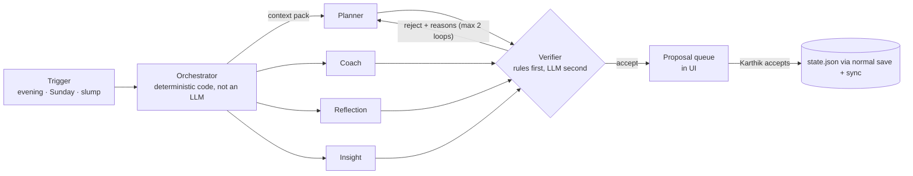

# V2 plan: AI agents and orchestration (not built in v1)

Status: proposal, researched October 2026. Nothing here ships in v1; v1 stays rule-based, offline and free. This plan describes how an optional AI layer plugs into the existing data contract without making Steady depend on it.

## 1. Principles
1. **Simplest thing that works.** Anthropic's guidance is to "find the simplest solution possible, and only increase complexity when needed", and to start with direct API calls rather than heavy frameworks ([Anthropic, *Building effective agents*](https://www.anthropic.com/engineering/building-effective-agents)). Most of Steady's AI value is single well-grounded LLM calls (a workflow), not autonomous agents.
2. **The rule engine stays the floor.** If AI is off, offline, or fails, v1 behaviour is unchanged.
3. **Data stays Karthik's.** On-device inference first; cloud only on explicit opt-in, per feature, with a visible "what is sent" preview.
4. **Agents read the contract, write proposals.** AI never writes `state.json` directly; it returns *proposals* (tasks, milestone edits, reflections) that Karthik accepts in the UI, which then save as normal records. This keeps merge semantics and history clean.

## 2. Agents (roles, inputs, outputs)
| Agent | Job | Inputs (from the data contract) | Output (proposal) | Trigger |
| --- | --- | --- | --- | --- |
| **Planner** | Turn goals + this week's milestone + realistic load into tomorrow's 3–5 tasks with times in his best window. | goals, open tasks, engine `loadCap`, `best`, `wdRate`, profile wake/sleep | task proposals with `dueTime`, `durationMin`, `goalId` | Evening after check-in; "Plan my week" on Sunday |
| **Coach** | Short, specific nudges in Steady's voice when he's slipping; reframes a slump into one tiny action. | engine `slump`, streak, recent check-ins, thoughts tagged `#reflection` | 1–2 sentences + optional tiny task | Day start after a slump; missed reminder |
| **Reflection** | Turns the week's check-ins and thoughts into a 5-line weekly review and asks one question. | checkins (win, selfCare, energy), thoughts, done tasks | review text saved as a `journal` thought on accept | Sunday evening |
| **Insight** | Explains patterns the rules can't phrase well ("you skip long DSA blocks on Mondays after late nights") with evidence. | aggregates from `analyzeData()` (not raw text by default) | insight sentences + evidence, shown in "What I've learned" with an AI badge | Weekly |
| **Verifier** (non-user-facing) | Checks proposals against hard rules: within waking hours, ≤ load cap, no duplicates, goal ids exist, tone rules. | proposal + contract | accept / reject with reasons | Every proposal |

## 3. Orchestration pattern
Start with **orchestrator → specialised workers + a generator–verifier loop**, the pattern Anthropic recommends as the default starting point ("For most use cases, we recommend starting with orchestrator-subagent"), with generator-verifier for "quality-critical output with explicit evaluation criteria" ([Claude blog, *Multi-agent coordination patterns*, Apr 2026](https://claude.com/blog/multi-agent-coordination-patterns)). OpenAI's guidance matches: "Start with one agent whenever you can", and use a manager that calls specialists "as tools" when it should own the final answer ([OpenAI, *Orchestration and handoffs*](https://developers.openai.com/api/docs/guides/agents/orchestration)).

- The **orchestrator is plain code** (routing by trigger), so it's testable and free; only workers call a model. This is "routing" + "prompt chaining" from Anthropic's catalogue, upgraded to orchestrator-workers only if planning needs dynamic sub-tasks.
- **Verifier first runs deterministic checks** (times inside wake/sleep, count ≤ `loadCap`), then optionally an LLM tone check. A max-iteration limit with fallback avoids the non-converging loop failure mode the Claude post warns about.
- **Context packs** are small, typed JSON built by `core/engine.js` (aggregates, last 7 days), never the whole repo, to fit on-device context limits.

## 4. Model options
| Option | Where | Status (as of Oct 2026) | Fit |
| --- | --- | --- | --- |
| **Chrome Prompt API (Gemini Nano)** | Desktop Chrome, in-page | Shipping on the web in Chrome 148; Windows/macOS/Linux/ChromeOS Plus only; **not on Chrome for Android**; needs ~22 GB free disk and > 4 GB VRAM or 16 GB RAM; supports JSON-schema `responseConstraint`; no data sent to Google ([Chrome for Developers, *The Prompt API*](https://developer.chrome.com/docs/ai/prompt-api)) | Laptop: Insight/Reflection/Coach on-device, structured output for proposals |
| **ML Kit GenAI Prompt API (Gemini Nano via AICore)** | Native Android | Beta (`com.google.mlkit:genai-prompt:1.0.0-beta4`), API 26+, input < 4,000 tokens, per-app quota, supported devices only ([Google, *Get started with Prompt API*](https://developers.google.com/ml-kit/genai/prompt/android/get-started); [Android, *Gemini Nano*](https://developer.android.com/ai/gemini-nano)) | Phone, once Steady has a native shell (v3); not reachable from a PWA |
| **WebLLM** | Any WebGPU browser | Open-weight models in-browser, OpenAI-compatible API ([WebLLM docs](https://webllm.mlc.ai/docs/)) | Fallback on laptops without the Prompt API; heavy downloads, so opt-in |
| **Cloud LLM API** (Claude / Gemini / OpenAI) | Network | Generally available; pay per token | Best quality for weekly planning; opt-in only, with redaction and a cost cap |

Recommended path: **laptop on-device (Prompt API) → phone uses results via sync**. Proposals generated on the laptop sync to the phone as a `proposals` collection, so the Android PWA benefits without on-device AI. Cloud is a per-feature opt-in.

## 5. Plugging into the existing contract
- New synced collection **`proposals`** (schemaVersion 2 migration): `{ id, updatedAt, agent, kind: 'task'|'milestone'|'reflection'|'insight', payload, status: 'pending'|'accepted'|'dismissed', evidence[], model, createdAt }`. Accepting writes normal `tasks`/`goals`/`thoughts` records; merge rules unchanged.
- New device-local settings: `ai.enabled`, `ai.provider` (`prompt-api` | `webllm` | `cloud`), `ai.cloudKey` (local only, like the sync token), `ai.monthlyCapINR`.
- **Plugin interface** (same shape for Hark and in-app agents): `read(contract) → context pack`, `propose(context) → Proposal[]`, never `write`. Hark keeps reading `data/state.json` / `snapshot.json`; it can also *write* proposals into `proposals`, which Steady shows exactly like its own.
- **MCP**: expose the contract as an MCP server (resources: `steady://tasks`, `steady://insights`; tools: `propose_task`, `log_checkin`) so any MCP host can act as a Steady agent. MCP standardises resources, prompts and tools over JSON-RPC ([MCP specification, 2026-07-28](https://modelcontextprotocol.io/specification/latest)).

## 6. Privacy
- Default: aggregates only (counts, rates, windows); free text (thoughts, wins) leaves the device only when a feature that needs it is explicitly enabled.
- Cloud requests show a preview of the exact payload the first time; a redaction pass strips names/emails/phone numbers.
- Keys and tokens remain device-local; nothing is added to the synced repo except accepted results and proposals.

## 7. Cost
- On-device: free after model download.
- Cloud (estimate, to be confirmed against the provider's pricing page at build time): Planner nightly + Reflection weekly ≈ 35 calls/month × ~3k input + ~600 output tokens ≈ 0.13M tokens/month; small/fast model tiers keep this to a few rupees a month. Enforce `ai.monthlyCapINR` client-side; route easy calls to the smallest model, as Anthropic's routing pattern suggests.

## 8. Evaluation
- Golden fixtures: 30-day seeded histories (reuse `js/data/demo.js`) with expected properties (plans inside waking hours, ≤ load cap, reference the current milestone).
- Verifier pass rate, proposal acceptance rate, and the PRD's consistency metrics (active days/week) before vs after enabling AI.

## 9. Milestones
| Milestone | Scope | Exit criteria |
| --- | --- | --- |
| **M0: contract** | `proposals` collection, schemaVersion 2 migration + tests, proposal UI (accept/dismiss). | Migration tests green; v1 clients refuse to write v2 data (already enforced). |
| **M1: Insight on-device** | Prompt API feature detection, Insight agent with JSON-schema output, verifier rules. | Works offline on laptop; degrades silently elsewhere. |
| **M2: Planner + Verifier** | Evening "plan tomorrow" proposals; deterministic verifier; 2-loop max. | ≥ 60 % proposals accepted over 2 weeks. |
| **M3: Coach + Reflection** | Slump nudges, Sunday review. | Return-after-gap ≤ 1 day in 80 % of gaps. |
| **M4: cloud opt-in + MCP** | Provider abstraction, cost cap, MCP server for Hark/others. | Payload preview, cap enforced, Hark proposals visible in Steady. |

## Sources
- Anthropic, *Building effective agents* (Dec 2024, updated note): https://www.anthropic.com/engineering/building-effective-agents
- Claude blog, *Multi-agent coordination patterns: Five approaches and when to use them* (Apr 10, 2026): https://claude.com/blog/multi-agent-coordination-patterns
- OpenAI, *Orchestration and handoffs*: https://developers.openai.com/api/docs/guides/agents/orchestration
- Chrome for Developers, *The Prompt API* (updated Aug 26, 2026): https://developer.chrome.com/docs/ai/prompt-api
- Google, *ML Kit GenAI: Get started with Prompt API* (updated Sep 8, 2026): https://developers.google.com/ml-kit/genai/prompt/android/get-started
- Android Developers, *Gemini Nano*: https://developer.android.com/ai/gemini-nano
- WebLLM documentation: https://webllm.mlc.ai/docs/
- Model Context Protocol specification (2026-07-28): https://modelcontextprotocol.io/specification/latest
